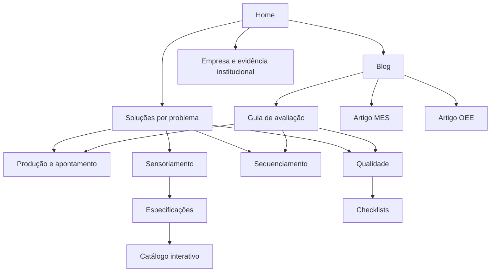

# Estratégia de SEO, GEO e AEO da MESTTI

Decisão editorial e técnica de 21/10/2026. Base examinada: `origin/main` em `ef82bae`. Este documento descreve a implementação proposta; não comprova publicação, indexação ou crescimento comercial. O plano anterior à implementação está em [PLAN.md](PLAN.md), as fontes em [RESEARCH.md](RESEARCH.md) e os testes em [VALIDATION.md](VALIDATION.md).

## O problema e a posição que queremos explicar

A MESTTI combina sensores e software para gestão da execução industrial: produção por máquina, apontamento digital, paradas, indicadores, programação visual e inspeções. O site deve permitir que um empresário que procura “quanto minha fábrica produziu hoje” e um analista que procura “MES, OEE e PCP” cheguem à mesma explicação verificável do produto.

A fonte de capacidade é o produto e a documentação canônica do projeto, confrontados com as páginas já publicadas. Código interno que contém um módulo não prova disponibilidade comercial em todos os planos. Por isso não lançamos no site promessas de APS autônomo, diagnóstico preditivo, integração universal, conformidade regulatória ou rastreabilidade integral de lotes. Tampouco introduzimos a marca de IA do projeto interno sem briefing comercial específico.

O diferencial comunicável é ligar o evento da máquina ao contexto da equipe e à decisão da gestão. Não afirmamos exclusividade no mercado. Medir não é melhorar automaticamente: a equipe precisa validar a coleta, os cadastros e agir sobre as causas.

## O que significa otimizar neste projeto

SEO trata descoberta, processamento e apresentação em busca. AEO dá atenção às perguntas e à clareza das respostas. GEO acrescenta a observação de como respostas generativas recuperam fontes, citam páginas e descrevem fornecedores. São frentes sobrepostas, sem um “schema de IA” que force recomendação.

Há quatro eventos distintos: uma página ser recuperada, ser citada, a empresa ser mencionada e a empresa entrar numa recomendação. Um guia pode ser fonte útil sem gerar recomendação comercial. Modelo sem busca e produto com busca são condições diferentes. Nome de modelo não revela sozinho o provedor de busca nem a política de seleção de fontes.

Aplicamos: texto útil entregue em HTML, relações entre páginas compreensíveis, definições precisas, informações empresariais consistentes e evidência primária para reconhecimento institucional. Mantemos o `llms.txt` existente como conveniência de navegação. Não o tratamos como requisito ou fator de ranking. Não acrescentamos OKF, WebMCP, prompts escondidos, listas de recomendações próprias ou variantes de páginas por formulação de pergunta.

## Intenções de compradores e arquitetura

A lista de pesquisas enviada pelo usuário foi tratada como corpus qualitativo de intenções, não como volume de busca, transcrição de entrevista ou ranking observado. Os marcadores `fast|` e `length|` são artefatos do registro e foram ignorados como instruções. [query-intents.json](query-intents.json) registra famílias, exemplos, destinos e limites.

As quatro frentes editoriais são:

- **Execução e perdas:** `/producao/` explica o acompanhamento, o apontamento e o contexto; o artigo de OEE aprofunda os indicadores.
- **Coleta e implantação:** `/sensoriamento/` explica o projeto de coleta; `/sensores/` contém especificações; `/atuacao/` permanece como catálogo interativo. Mantemos as três URLs porque têm tarefas distintas, com links que explicitam essa diferença.
- **Planejamento e execução:** `/sequenciamento/` apresenta programação visual; o guia explica o que perguntar sobre PCP, capacidade e APS, sem prometer automação não confirmada.
- **Verificação e qualidade:** `/qualidade/` é a entrada industrial; `/checklists/` atende outras rotinas e segmentos. Sobreposição do recurso não torna as necessidades idênticas. Consolidar essas URLs agora apagaria diferenças úteis.

O novo `/solucoes/` reúne problemas e encaminha para essas frentes. O novo `/blog/como-escolher-sistema-monitoramento-producao/` oferece critérios de compra e um roteiro de piloto. O artigo de MES existente já explica a relação com ERP e não precisava de uma duplicata. A home ganha uma definição de categoria e acesso aos dois caminhos novos. O menu “Soluções” funciona com um link HTML, sem depender de manipulação de destino por JavaScript.

Hierarquia principal:

Não criamos páginas para cada cidade, segmento, sigla ou concorrente. As consultas sobre marcas citadas na lista orientam pesquisa competitiva; não são permissão para inventar comparações ou páginas “melhores fornecedores”. Algumas grafias e identidades dessa lista ainda precisam ser verificadas antes de qualquer comparação pública.

## Conteúdo, prova e confiança

1. Três artigos existentes passam a entregar o português completo no HTML. Os dicionários atuais continuam como fonte do texto; `npm run content:sync` atualiza as cópias estáticas e o build falha se houver drift. A tradução no navegador permanece.
2. A página de Qualidade teve caracteres corrompidos corrigidos. A correção inclui conteúdo, atributos e metadados; não altera regras do produto.
3. Os nomes de pessoas e a aparência de depoimento dos seis exemplos de checklists foram substituídos por situações ilustrativas. Não havia evidência de depoimentos autorizados no repositório. Os indicadores demonstrativos da home ganham rótulos próximos.
4. A seleção no Lab Procel II agora aponta para a publicação da ENBPar. Usamos o fato confirmado de estar entre cinco selecionadas, sem a alegação de exclusividade regional. Seleção para aceleração não vira certificação ou prova de resultado.
5. O guia declara autoria coletiva e vínculo comercial com a MESTTI. Não inventamos especialista, experiência, credencial, cliente, resultado ou data antiga para o artigo novo.
6. O guia e as soluções esclarecem que corrente, contagem, motivo de parada, inspeção e manutenção preditiva não são equivalentes. A alimentação do coletor USB é descrita como 5 V; a entrada da fonte é uma especificação separada.

Os logos de clientes e as afirmações comerciais já existentes que não receberam evidência independente nesta execução não foram transformados em cases nem em dados estruturados de avaliações. A manutenção editorial deve reunir autorização e evidência antes de publicar um case com identidade e números.

## Implementação técnica

- Canonical absoluto, título e descrição por intenção, metadados sociais e JSON-LD coerentes. Traduções pt que atualizam metadados foram sincronizadas; en/es continuam como conveniência de interface, sem `hreflang` para URLs inexistentes.
- Organização na home com razão social, CNPJ, contatos, logo e perfis públicos já presentes no site. Referências usam IDs estáveis. Não inventamos endereço físico, preço, nota, reviews ou `offers` para obter rich results.
- Breadcrumbs visíveis e `BreadcrumbList` concordam na hierarquia. O guia novo usa `Article`. FAQs antigas continuam representando perguntas visíveis; não se promete o recurso de FAQ do Google, descontinuado em 2026.
- CMMS em construção e o agregador utilitário Pass recebem `noindex, follow`; ficam acessíveis, fora do sitemap. A versão alternativa `index.md` recebe `X-Robots-Tag: noindex` para não competir com a home.
- Mantemos `User-agent: * / Allow: /`. Não precisamos mudar a política de treinamento para permitir descoberta: ela já permitia os robôs. Robôs de busca, requisições iniciadas por usuários e coleta para treinamento têm funções diferentes. CDN/WAF deve ser conferido separadamente após uma publicação autorizada.
- Redirecionamentos explícitos só para URLs de documentos e aliases. Não aplicamos uma política global de barras que possa alterar chamadas de API. Parâmetros de campanha são preservados no servidor local.
- Sete imagens ganham versões WebP menores; originais preservados. Não adicionamos dependência de runtime nem substituímos o mecanismo 3D.
- Landmarks, atalho de teclado para conteúdo, foco visível e nomes acessíveis dos selects são melhorias pequenas compatíveis com a interface existente.
- Build exclui arquivos internos de briefing e exemplo de ambiente. Verificação offline cobre fonte e saída publicada.

O preview automático desta branch está desabilitado em `git.deploymentEnabled` no `vercel.json`, respeitando a solicitação de não fazer deploy. Não há merge nem execução de publicação neste trabalho.

## Operação e evolução

**A cada edição:** validar a afirmação contra o produto, atualizar o dicionário quando aplicável, executar `npm run content:sync`, `npm run check:site`, `npm test`, `npm run build`, conferir o layout e a interação afetada. Não renovar datas sem revisão efetiva. Não preencher `lastmod` por horário de build.

**Depois de uma publicação autorizada:** verificar redirects no CDN, URL Inspection, teste de resultados enriquecidos por URL, sitemap em Search Console e Bing Webmaster Tools, respostas a robôs e erros de rastreamento. São tarefas de conta/provedor que o PR não pode provar localmente.

**Medição mensal:** manter 15–20 intenções estáveis do corpus, com busca habilitada quando disponível. Registrar produto/modelo, idioma/região, data, contexto novo, texto exato, fontes e tipo de presença. Fazer 3–5 repetições por intenção e plataforma; relatar numerador/denominador. Não considerar uma execução evidência de ranking. Não misturar resultados de uma API com o produto de consumo.

Cruzar impressões/cliques por página e família de consultas, tráfego referido por assistentes e contatos qualificados. Usar o fluxo de consentimento existente e não transmitir dados pessoais como “evento SEO”. Aumento de buscas de marca ou acessos diretos pode ter múltiplas causas; não atribuir tudo a IA. Citações sem contato qualificado não são a única medida de sucesso.

**Próximos investimentos com evidência:** documentação por kit de sensor; demonstração gravada e legendada com dados identificados como exemplo; case autorizado com baseline, período e método; exemplos de inspeção reais anonimizados; material de implantação com requisitos e limites confirmados; perfis externos institucionais consistentes. A prioridade comercial deve ser ajustada com Search Console e conversas de vendas, que não estavam disponíveis nesta execução.
